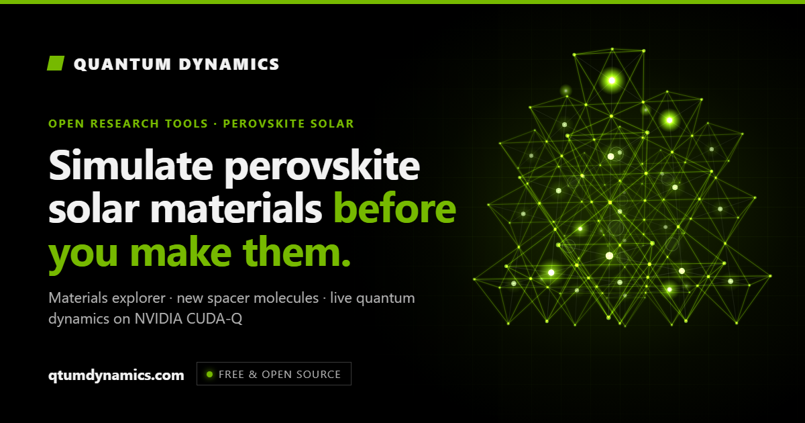
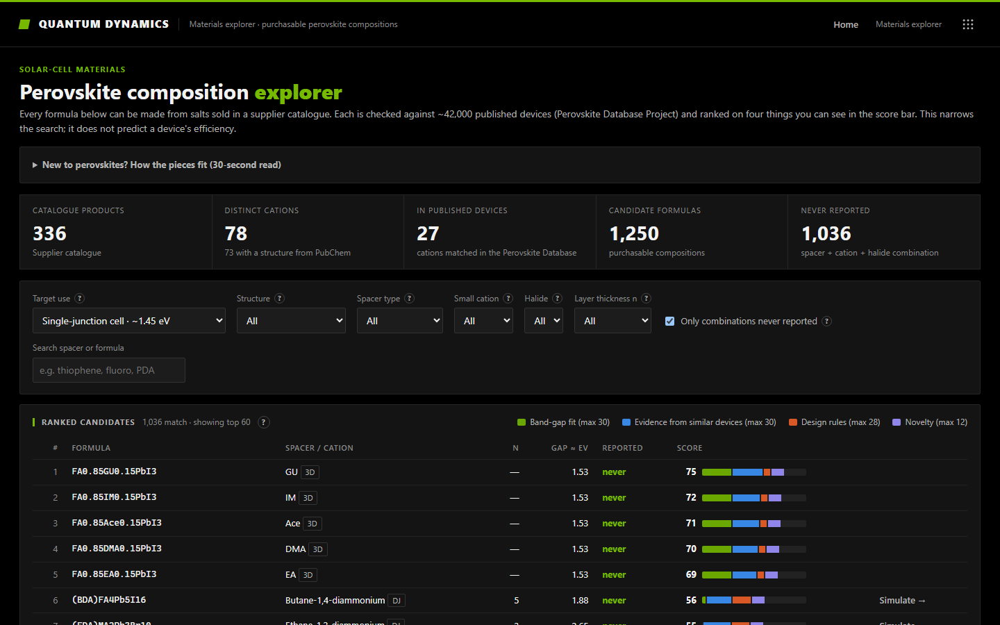
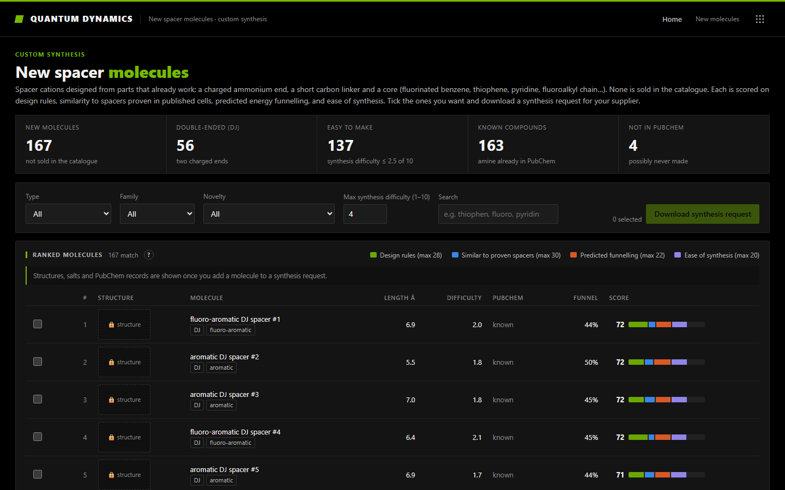
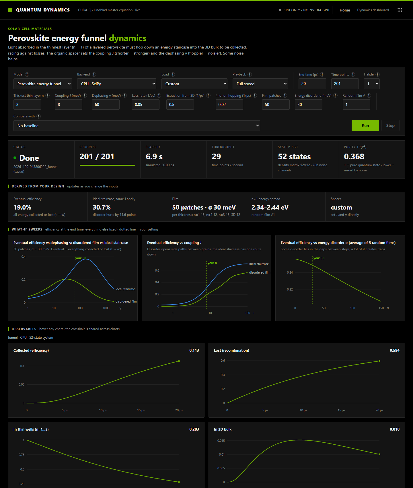
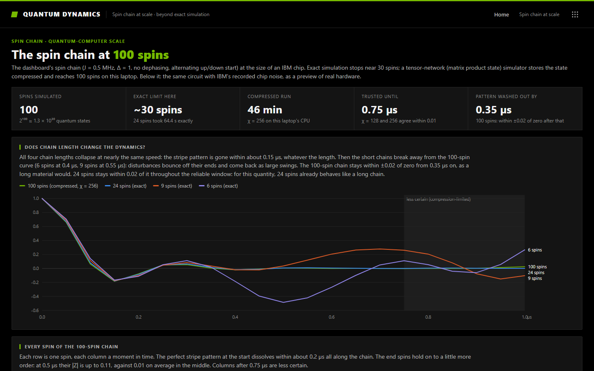
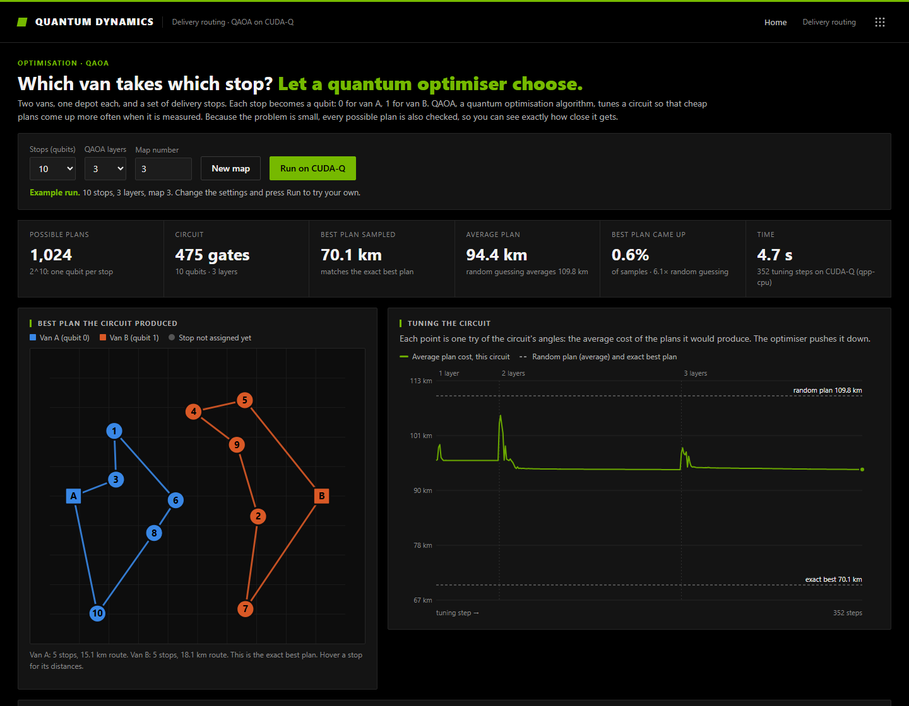
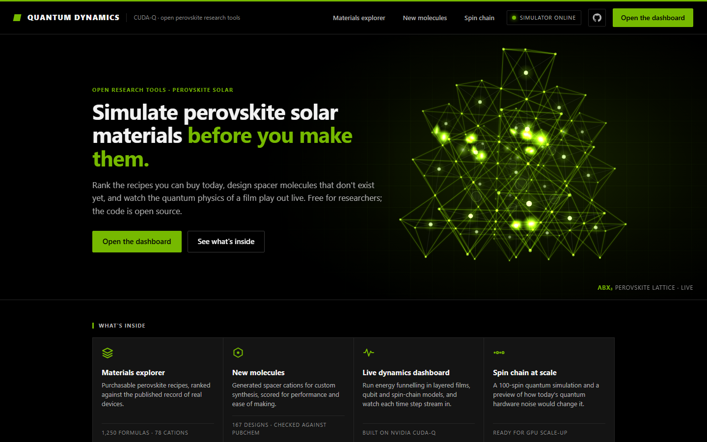
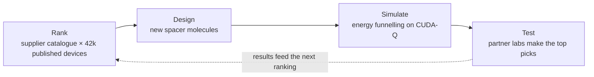
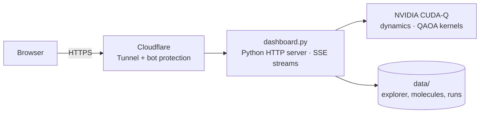

<div align="center">

<a href="https://qtumdynamics.com"></a>

# Quantum Dynamics

**Open research tools for perovskite solar materials, built on NVIDIA CUDA-Q.**

Rank the recipes you can buy today, design spacer molecules that don't exist yet,
and watch the quantum physics of a film play out live.

[](https://qtumdynamics.com)
[](LICENSE)
[](https://nvidia.github.io/cuda-quantum/)
[](deploy/Dockerfile)
[](deploy/README.md)

[**Open the live site**](https://qtumdynamics.com) · [What's inside](#whats-inside) · [How it works](#how-it-works) · [Run it yourself](#run-it-yourself) · [Developer guide](#developer-guide)

</div>

---

## Why

Perovskite solar cells are cheap to make and close to silicon in efficiency, but there are thousands of
possible recipes, and each lab test takes weeks. Quantum Dynamics narrows the search **before** anything is
made. It ranks compositions you can actually buy against the published record of real devices, proposes new
spacer molecules where the catalogue runs out, and simulates how energy moves through a layered film.

Everything is free to browse at **[qtumdynamics.com](https://qtumdynamics.com)**. A free sign-up (name and
email, no password) lets you run simulations, save runs and download synthesis requests. This repository is
the whole site.

## What's inside

<table>
  <tr>
    <td width="50%" valign="top">
      <a href="https://qtumdynamics.com/explorer"></a>
      <h3>Materials explorer</h3>
      <p>1,250 purchasable perovskite formulas built from a supplier's salts. Each is checked against ~42,000
      published devices and scored on band-gap fit, evidence, design rules and novelty.</p>
      <p><a href="https://qtumdynamics.com/explorer"><code>/explorer</code></a> · <code>materials/build_explorer.py</code></p>
    </td>
    <td width="50%" valign="top">
      <a href="https://qtumdynamics.com/molecules"></a>
      <h3>New molecules</h3>
      <p>167 generated spacer cations that aren't in the catalogue. Each is scored for predicted energy
      funnelling and ease of synthesis (RDKit) and checked against PubChem. Pick some and download a synthesis request.</p>
      <p><a href="https://qtumdynamics.com/molecules"><code>/molecules</code></a> · <code>materials/generate_molecules.py</code></p>
    </td>
  </tr>
  <tr>
    <td width="50%" valign="top">
      <a href="https://qtumdynamics.com/dashboard"></a>
      <h3>Live dynamics dashboard</h3>
      <p>Lindblad master-equation models on CUDA-Q, streamed step by step: energy funnelling in layered films
      (including disordered films), a transmon qubit, qubit readout and spin chains. It includes what-if
      sweeps and run comparison.</p>
      <p><a href="https://qtumdynamics.com/dashboard"><code>/dashboard</code></a> · <code>sim.py</code> <code>funnel.py</code> <code>transmon.py</code></p>
    </td>
    <td width="50%" valign="top">
      <a href="https://qtumdynamics.com/chain"></a>
      <h3>Spin chain at scale</h3>
      <p>The dashboard's spin chain at 100 spins (2<sup>100</sup> states) with a matrix-product-state simulator,
      checked against exact runs, plus a preview with an IBM chip's recorded noise.</p>
      <p><a href="https://qtumdynamics.com/chain"><code>/chain</code></a> · <code>ibm/</code></p>
    </td>
  </tr>
  <tr>
    <td width="50%" valign="top">
      <a href="https://qtumdynamics.com/routing"></a>
      <h3>Delivery routing (QAOA)</h3>
      <p>Beyond materials: a quantum optimisation algorithm splits 6–12 delivery stops between two vans, with
      one qubit per stop. The angles are tuned live on CUDA-Q, and every possible plan is checked so you can see
      how close it gets.</p>
      <p><a href="https://qtumdynamics.com/routing"><code>/routing</code></a> · <code>routing.py</code></p>
    </td>
    <td width="50%" valign="top">
      <a href="https://qtumdynamics.com"></a>
      <h3>Home page</h3>
      <p>A live ABX<sub>3</sub> lattice in plain canvas, a QAOA circuit animation (Anime.js), and an open-by-default
      design: anyone can look around, and sign-up is only asked for when you run something.</p>
      <p><a href="https://qtumdynamics.com"><code>/</code></a> · <code>landing.html</code></p>
    </td>
  </tr>
</table>

## How it works



1. **Rank.** Match what suppliers sell against thousands of published devices.
2. **Design.** Generate new spacer molecules from proven parts where the catalogue runs out.
3. **Simulate.** Model how light energy hops down the layered film's energy staircase, from a laptop CPU up to GPUs.
4. **Test.** Partner labs make the top picks, and their results feed the next ranking.

### Architecture



- **One small server.** `dashboard.py` is a standard-library Python server. Pages are plain HTML, CSS and
  JavaScript with no build step and no framework. Live runs stream to the browser as server-sent events.
- **Physics.** CUDA-Q 0.16 runs the master-equation solvers and quantum circuits, on CPU by default and on
  the `dynamics` (cuDensityMat) target on an NVIDIA GPU. SciPy is used for exact checks.
- **Chemistry.** RDKit, PubChem lookups and GFN2-xTB vibrations.
- **Hosting.** A hardened, CPU-only Docker container behind a Cloudflare Tunnel. Visitors' data requests need
  a signed visit cookie, and everyone is rate limited. See [`deploy/README.md`](deploy/README.md).

## Run it yourself

The site runs on a laptop. On Windows, use WSL Ubuntu:

```bash
bash setup_wsl.sh         # once: installs uv + CUDA-Q 0.16 into ~/cudaq-env
bash start_dashboard.sh   # then open http://localhost:8765
```

Running locally, there's no sign-up gate: every tool works straight away. Pages whose data files are missing
say which script builds them (see [Data](#data)).

Or try the solver on its own:

```bash
~/cudaq-env/bin/python sim.py --model cavity --kappa 0.1 --chi 2
~/cudaq-env/bin/python sim.py --model spinchain --spins 8 --gamma 0.05 --delta 2
~/cudaq-env/bin/python routing.py --stops 10 --layers 3 --seed 3
```

To host it, `deploy/` builds the container and runs it behind a Cloudflare Tunnel (`.\deploy\push.ps1 -Up` from
PowerShell). See [`deploy/README.md`](deploy/README.md).

## Honest limits

- **Predictions, not measurements.** Rankings and simulations narrow the search; they don't predict a
  device's efficiency. Band gaps are typical values per layer thickness and halide, not calculations.
- **Delivery routing shows the method, not a speed-up.** At these sizes a laptop checks every plan instantly,
  and classical solvers still beat QAOA on real routing problems.
- **CPU in production.** The live site runs CUDA-Q on CPU. The GPU path is built and checked, but you need
  your own NVIDIA GPU (see [AWS GPU](#run-it-on-an-nvidia-gpu-in-aws)).

## Data

Large data files aren't in this repository. Rebuild or download them into `data/`:

| File | Where it comes from |
|---|---|
| `data/perovskite_db/` | [The Perovskite Database Project](https://www.perovskitedatabase.com/) (Jacobsson et al., *Nature Energy* 2022), CC BY 4.0. Download the full CSV export. |
| `data/catalogue.json` | A supplier's product catalogue, fetched by `materials/fetch_catalogue.py`. Point it at your own supplier. |
| `data/explorer.json` | `build_materials.sh` (needs the two above, RDKit and PubChem lookups). |
| `data/new_molecules.json`, `data/vibrations.json` | `generate_molecules.sh`, then `vibrations.sh`. |

Included: the spin-chain results in `data/ibm/` and the routing example in `data/routing_example.json`. Only
public CAS numbers and SMILES are ever sent to PubChem.

---

## Developer guide

<details>
<summary><b>Project layout</b></summary>

```
dashboard.py          HTTP server: pages, APIs, live run streams, sign-up, admin
sim.py                CUDA-Q dynamics models (cavity, spin chain) + CPU/GPU backends
funnel.py             energy funnelling in layered perovskite films (incl. disordered films)
transmon.py           the transmon qubit (Koch et al. 2007), solved in the charge basis
routing.py            QAOA delivery routing on CUDA-Q
explorer_api.py       materials explorer API (paged, scored on the server)
materials/            catalogue fetcher, explorer builder, molecule generator, xTB vibrations
ibm/                  Qiskit spin-chain circuits, IBM noise preview, 100-spin MPS run
*.html, nav.js        the pages and the shared menu (no build step)
static/               icons, social card, Anime.js and the home-page animations
deploy/               Dockerfile, compose, Cloudflare Tunnel, push script
aws/gpu.ps1           run the dashboard on an AWS GPU instance
```
</details>

<details>
<summary><b>Quantum dynamics sandbox: CPU and GPU backends</b></summary>

A build-your-own version of NVIDIA's blog post "Accelerating Google's QPU development with new quantum dynamics
capabilities". `sim.py` describes a quantum device once, using CUDA-Q operators, then runs it on:

| backend | where | needs |
|---|---|---|
| `cpu` | a laptop (WSL Ubuntu) | nothing extra; fine up to ~8 spins / a few hundred states |
| `gpu` | Colab, Brev or any cloud box with an NVIDIA GPU | the `dynamics` target (cuDensityMat) |
| `both` | GPU machine | runs both and prints how far apart the answers are |

Apple silicon: CUDA-Q installs and runs the CPU path, but the `dynamics` GPU solver needs an NVIDIA GPU.

```bash
bash run_cpu_demo.sh       # plots and CSVs go to output/
```

**On a GPU (Google Colab; a T4 runtime is enough to start):**

```bash
!pip install cudaq matplotlib
# upload sim.py, then:
!python sim.py --model cavity --backend both          # check CPU and GPU agree first
!python sim.py --model spinchain --spins 12 --backend gpu --gamma 0.05
```

**Live dashboard.** Pick a model, a **Load** preset (Quick → Max CPU) and **Playback** (full speed or slow
motion), then **Run**. Every time point streams in as it is solved: one chart per measured quantity, the
purity of the quantum state, a heatmap (photon-number distribution or per-spin up/down), progress, throughput
and time left. **Compare with** overlays any earlier run as a dashed baseline. Runs are saved in
`output/runs/`. Deep link to a saved run: `/dashboard#view=<run id>&compare=<run id>`.
</details>

<details>
<summary><b>Run it on an NVIDIA GPU in AWS</b></summary>

<a id="run-it-on-an-nvidia-gpu-in-aws"></a>From PowerShell in this folder, after `aws login`:

```powershell
.\aws\gpu.ps1 up        # launches g6/g5/g4dn.xlarge (first offered) with the Deep Learning GPU AMI
.\aws\gpu.ps1 deploy    # copies code, installs CUDA-Q, checks CPU vs GPU agree, starts the dashboard
.\aws\gpu.ps1 tunnel    # then open http://localhost:8766 (GPU dashboard; the local one stays on 8765)
.\aws\gpu.ps1 down      # terminate when finished: GPU instances bill by the hour
```

SSH is allowed only from your current IP, and the dashboard is reachable only through the SSH tunnel. New AWS
accounts often have a GPU quota of 0: in Service Quotas, request at least 4 vCPUs of "Running On-Demand G and VT
instances" first. On the GPU, pick backend **GPU** and the **GPU · 14 spins** preset.
</details>

<details>
<summary><b>Models</b></summary>

- **cavity**: a superconducting qubit coupled to its readout resonator (dispersive shift `chi`, photon leak
  `kappa`, starting pulse size `alpha`). Shows how measuring the qubit destroys its superposition.
- **spinchain**: N interacting spins (`J`, anisotropy `delta`, dephasing noise `gamma`), the system the blog
  benchmarked at 14 qubits on one H100.
- **transmon**: the superconducting qubit from Koch et al., *Charge-insensitive qubit design derived from the
  Cooper pair box*, Phys. Rev. A 76, 042319 (2007), arXiv:cond-mat/0703002 (`transmon.py`). Solved exactly in the
  charge basis. The dashboard redraws the paper's key figures live as you move `E_J/E_C`: energy levels vs offset
  charge, charge dispersion falling exponentially, and anharmonicity shrinking slowly. It shows derived numbers
  (f01, α, charge dispersion, T2 limit from charge noise) and simulates a resonant drive, including leakage to
  |2⟩. Presets: Transmon (E_J/E_C = 50), Cooper pair box (E_J/E_C = 1, a stray charge detunes it), Fast drive
  (leakage), Long run. CPU only, a few levels. Simplifications: rotating-wave drive, and a Markovian stand-in
  for 1/f charge noise (A = 1e-4 e).
- **funnel**: energy funnelling in a layered (quasi-2D) perovskite solar absorber (`funnel.py`). Wells
  n = 1…n_max and the 3D bulk, coupled by J, dephased by γ, with losses and extraction. The what-if sweeps show
  noise-assisted transport: efficiency peaks at intermediate γ. Units: meV, ps.
  - **Disordered film:** set "Film patches" > 0, or pick the "Disordered film · 50 patches" preset. This builds
    a random but reproducible cross-section of grains, with thin n near the substrate and 3D near the top.
  - **Disorder model:** each grain's energy is shifted by Gaussian disorder σ, and nearby grains are coupled by
    J·(d0/r)³. Light starts spread over all n = 1 grains.
  - **Eventual efficiency:** the extras report efficiency at t → ∞ against the ideal staircase. It's solved
    directly from the master equation in ~20 ms, exactly, and checked against a brute-force solve. 50 patches
    gives 52 states and a live run of ~11 s.

  `start_dashboard.sh` pins OpenBLAS to 8 threads: WSL's default of 22 made linear algebra ~10× slower.

**Adding your own model.** Write a `model_x(a)` function that returns `H, dims, collapse_ops, observables, psi0,
times`, and register it in `MODELS`. Both backends pick it up automatically.
</details>

<details>
<summary><b>Delivery routing (QAOA)</b></summary>

`routing.py` makes a map of 6–12 stops and two depots. Each stop is one qubit: 0 sends it to van A, 1 to van B.

- **Cost.** A plan's cost is each stop's distance to its van's depot, plus a pairing term for stops sharing a
  van, plus a load-balance penalty. Written as an Ising model, it becomes the QAOA cost layer (`rz` for single
  terms, `cx-rz-cx` for pairs), followed by an `rx` mixer.
- **Tuning.** Every tuning step runs the circuit on CUDA-Q (`get_state` gives the exact average plan cost).
  The starting angles come from a 720-point scan of an exact NumPy copy of the circuit. COBYLA then tunes layer
  by layer within a time budget, so 12 stops with 4 layers finishes in about 16 s.
- **Sampling and checking.** The tuned circuit is sampled 2,000 times, and every one of the 2<sup>n</sup> plans
  is checked to find the exact best. Each van's driving order is solved classically (Held–Karp).

```bash
python routing.py --stops 10 --layers 3 --seed 3 --save   # writes data/routing_example.json for the page
```
</details>

<details>
<summary><b>Materials explorer and new molecules</b></summary>

**Materials explorer** ranks purchasable perovskite compositions built from the salts in a supplier catalogue.

```bash
python materials/fetch_catalogue.py   # export the supplier catalogue to data/catalogue.json
bash setup_materials.sh               # WSL, once: adds RDKit
bash build_materials.sh               # PubChem structures + Perovskite Database matching -> data/explorer.json
```

- **Data.** The Perovskite Database Project (Jacobsson et al., Nature Energy 2022), v1.0.1 snapshot from Zenodo
  (CC BY 4.0, devices up to February 2020), in `data/perovskite_db/`. PubChem structures are cached in
  `data/pubchem_cache.json`.
- **Score (0–100).** Band-gap fit to your target use, plus evidence from the same or the most similar reported
  cation, plus design rules (DJ, aromatic, fluorinated, short, rigid, thicker n), plus novelty. 3D candidates
  outside a tolerance factor of 0.8–1.0 are scaled by 0.4.
- **Simulate →** opens the funnel model with J and γ estimated from the spacer (an illustrative mapping).
- **Limits.** Band gaps are typical values per n and halide, not calculations. Database matching is by
  abbreviation. The explorer narrows the search; it doesn't predict device efficiency.

**New molecules** designs spacer cations that aren't in the catalogue, built from proven parts.

```bash
bash generate_molecules.sh            # needs data/explorer.json -> data/new_molecules.json
```

- **Parts.** An ammonium head, a CH2 linker and a core. Cores include fluorinated or halogenated benzenes,
  thiophenes, furan, pyridines, naphthalenes, fluoroalkyl and ether chains, and double-ended aromatic and alkyl
  diammoniums.
- **Score.** Design rules, plus similarity to spacers proven in published devices, plus predicted funnel
  efficiency (n = 5, FA, iodide), plus ease of synthesis (RDKit SA score).
- **Checks and export.** Each molecule is checked against PubChem, cached in `data/pubchem_smiles_cache.json`.
  Tick molecules and download `synthesis_request.csv` for the supplier.
</details>

<details>
<summary><b>Spacer vibrations (GFN2-xTB)</b></summary>

- **Setup.** `bash setup_xtb.sh` (once) installs `tblite` (GFN2-xTB, Grimme group) and ASE into
  `~/cudaq-env`.
- **What it computes.** `bash vibrations.sh` runs for the 6 round-1 spacers and every generated molecule: 173
  in total, ~2 min on 8 cores. For each NH3+ cation in implicit water it gives the vibration frequencies, the IR
  intensities, and the share of each vibration on the NH3+ head groups.
- **Output.** `data/vibrations.json`, shown as a chart in the detail panel on `/molecules` and `/explorer`
  ("Vibrations vs film energy steps"). Unstable (imaginary) modes are removed by nudging along them and
  re-optimising.

**First result.** Every spacer has vibrations near the small energy steps (50, 100 and 140 meV). None has any
within 10 meV of the two big steps: n=1→2 at 230 meV and n=5→3D at 330 meV. Those fall in the gap between
double-bond stretches and C–H stretches, so a single spacer vibration can't bridge them. GFN2-xTB frequencies
are typically within 5–10% of experiment (the NH3+ bend reads ~7% low), so check them against FTIR or Raman.
</details>

<details>
<summary><b>Spin chain on IBM hardware models, and at 100 spins</b></summary>

`bash setup_qiskit.sh` (once) installs Qiskit 2.6, Aer and qiskit-ibm-runtime into `~/cudaq-env`.

**The circuit.** `ibm/spinchain_qiskit.py` builds the dashboard's spin chain (H = 2πJ Σ XX+YY+ΔZZ, Néel start)
as a second-order Trotter circuit. Each bond step is one exact RXX·RYY·RZZ block.

**Step 1: free checks.** `bash ibm_step1.sh` runs these:
- **Against the dashboard solver** (J = 0.5 MHz, Δ = 1, 0–1 µs): the largest error is 0.017, using 33 ns steps
  (30 steps). The dashboard's Pauli convention makes the interaction ~4× stronger than J suggests. So 0–3 µs
  would need 100+ steps, which is too deep for hardware; 0–1 µs covers the collapse and first rebound.
- **With ibm_fez's recorded noise** (an offline snapshot, no error mitigation): errors reach 0.21–0.26 by 1 µs,
  and the signal flattens toward 0. Cost at 1 µs: 459 two-qubit gates for 6 spins, 732 for 9 spins.
- **Output:** `data/ibm/step1.json` and `output/ibm_step1.png`.

Dephasing γ can't be set on hardware (the chip's own noise plays that role), so the circuit uses γ = 0. Running on
real IBM hardware needs `IBM_QUANTUM_TOKEN` and `IBM_QUANTUM_INSTANCE` in `.env`.

**100 spins (the "Spin chain at scale" page).** `bash chain100.sh` runs the same chain at 100 spins with Qiskit
Aer's matrix-product-state simulator. It takes ~1 hour on a CPU: χ = 64, 128 and 256 take 1, 6 and 46 minutes.
- **Checks.** At 24 spins, χ = 128 is within 0.004 of the exact statevector run. At 100 spins, χ = 128 and 256
  agree within 0.01 until 0.75 µs; the page shades the region after that.
- **Finding.** All chain lengths collapse alike within ~0.15 µs. The 6- and 9-spin chains then break away
  (end echoes at 0.4 and 0.55 µs). The 100-spin chain stays within ±0.02 of zero from 0.35 µs. The 24-spin chain
  tracks it within 0.02.
- **Output.** `data/ibm/chain100.json` and `output/chain100*.png`.
- **Memory check.** Aer's matrix-product-state memory pre-check assumes no compression, so the script turns it off.
</details>

<details>
<summary><b>Page menu and keyboard</b></summary>

Every page has a nine-dot menu button at the right of the top bar (`nav.js`, shared). It has tiles for the five
tools and shortcuts to each dashboard model. Keyboard: <kbd>G</kbd> opens it, <kbd>1</kbd>–<kbd>5</kbd> jump to a
page, the arrow keys move, and <kbd>Esc</kbd> closes it. To add a page, add it to `PAGES` in `nav.js`.
</details>

<details>
<summary><b>Known issue (CUDA-Q 0.16)</b></summary>

`spin.i(0) * <boson operator>` breaks every later `to_matrix()` call in the process ("dimension for spin
operator must be 2"). Use `cudaq.operators.identity(0)` instead.
</details>

---

## Credits

- [NVIDIA CUDA-Q](https://github.com/NVIDIA/cuda-quantum): quantum simulation (a dependency, not part of this
  repository).
- [The Perovskite Database Project](https://www.perovskitedatabase.com/) (Jacobsson et al., *Nature Energy* 2022),
  CC BY 4.0.
- [PubChem](https://pubchem.ncbi.nlm.nih.gov/), [RDKit](https://www.rdkit.org/),
  [tblite / GFN2-xTB](https://github.com/tblite/tblite) and [Qiskit](https://www.ibm.com/quantum/qiskit).
- [Anime.js](https://animejs.com) v4 (MIT), vendored in `static/` for the home-page animations.

Quantum Dynamics is not affiliated with NVIDIA, IBM or the Perovskite Database Project.

## Licence

Apache 2.0. See [`LICENSE`](LICENSE) and [`NOTICE`](NOTICE). Issues and pull requests are welcome.

<div align="center"><sub>Built by <a href="https://qtumdynamics.com">Cintelis</a> · © 2026</sub></div>
